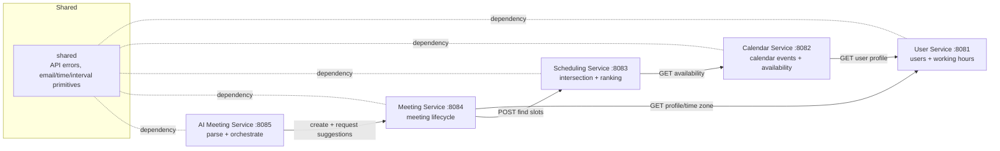

# Smart Meeting Scheduler

Java 21/Spring Boot scheduling application. **Current architecture: Phase 8 Docker-ready multi-module services**. Phases 1–7 are preserved as business behavior in the owning services; historical verification notes later in this document describe the former port-8080 monolith and legacy public schema.

## Technology stack

Java 21, Spring Boot 3.5, Spring Web, Spring Data JPA/Hibernate, PostgreSQL 16, Flyway, Maven, Jakarta Bean Validation, OpenAPI/Swagger, JUnit 5, Mockito, Docker, and Docker Compose. The five Spring Boot services communicate over REST; Scheduling and AI Meeting are stateless and database-free.


## Requirements and current entry points

- Java 21
- Maven 3.9+
- PostgreSQL 16
- User Service: `http://localhost:8081`
- Calendar Service: `http://localhost:8082`
- Scheduling Service: `http://localhost:8083`
- Meeting Service: `http://localhost:8084`
- AI Meeting Service: `http://localhost:8085`

The current local launch instructions, service database configuration, service ownership, and service diagram are in [Phase 6 — Service separation](#phase-6--service-separation). Docker Compose setup is in [Phase 8 — Docker](#phase-8--docker). The old root `mvn spring-boot:run` and port-8080 monolith instructions are retired.

## Current API / OpenAPI

User, calendar, scheduling, and meeting REST paths remain the same, served by their owning service on its port. Each service provides Swagger UI at `/swagger-ui.html` and OpenAPI JSON at `/v3/api-docs`.

Create a user with `POST /api/users`:

```json
{
  "email": "scheduler-demo-organizer@example.com",
  "displayName": "Demo Organizer",
  "timeZone": "Asia/Kolkata",
  "workingHours": [
    { "dayOfWeek": "MONDAY", "startTime": "09:00", "endTime": "12:00" },
    { "dayOfWeek": "MONDAY", "startTime": "13:00", "endTime": "17:00" }
  ]
}
```

`GET /api/users/{email}` returns the profile and its weekly working hours. Replace working hours with `PUT /api/users/{email}/working-hours` and a body shaped as `{ "workingHours": [ ... ] }`. Multiple non-overlapping intervals per weekday are supported.

### Manual Phase 2 PostgreSQL verification

Phase 2 was manually verified end-to-end against PostgreSQL 16.14 on `localhost:5432` using the `scheduler` role and the `smart_meeting_scheduler` database. Flyway V1 and V2 applied successfully, and the `users`, `user_working_hours`, `meetings`, `meeting_participants`, `calendar_events`, and `flyway_schema_history` tables were confirmed present.

The user API flow was exercised against the running application:

- `POST /api/users` created `scheduler-demo-organizer@example.com` in `Asia/Kolkata` and returned user ID `[omitted]`.
- `PUT /api/users/scheduler-demo-organizer@example.com/working-hours` stored two Monday intervals: 09:00–12:00 and 13:00–17:00.
- `GET /api/users/scheduler-demo-organizer@example.com` returned the profile and both intervals after the Spring Boot application was restarted.

This confirms the REST API → Controller → Service → Repository → JPA/Hibernate → PostgreSQL path and persistence across application restart for the verified user scenario.

Errors use a consistent JSON envelope with timestamp, HTTP status, message, request path, and optional field errors. Request DTOs use Jakarta Bean Validation. REST APIs exchange DTOs and do not expose persistence entities.

## Data and time handling

Flyway migration `V1__initial_schema.sql` creates `users`, `user_working_hours`, `meetings`, `meeting_participants`, and `calendar_events`, with foreign keys, checks, uniqueness constraints, and lookup indexes. Event and meeting instants use PostgreSQL `TIMESTAMPTZ`, Java `Instant`, and Hibernate's UTC JDBC setting. User zones are represented by `ZoneId`/IANA identifiers; weekly working hours are local `TIME` values associated with ISO weekdays. Overnight working intervals are not supported in this foundation.

Email value objects normalize addresses to lowercase before equality/comparison; the database also checks stored emails are normalized. Required/optional participation, meeting lifecycle, meeting type, and response state are enums.

## Tests

Run unit and Spring tests with:

```powershell
mvn test
```

Tests cover domain validation, user and calendar behavior, interval algorithms, scheduling, time zones, DST, REST APIs, PostgreSQL persistence, service HTTP boundaries, and AI orchestration. The full suite requires the dedicated `smart_meeting_scheduler_it` PostgreSQL database; setup and isolation rules are documented under Phase 6.

## Architecture and learning focus

The code is organized by service and domain boundary, with API DTOs, application services, domain types, and infrastructure/migrations kept distinct. `AvailabilityIntersectionService` owns reusable interval normalization/intersection. Phase 4 returns suggestions; the Meeting Service manages meeting lifecycle and persistence.

Phase 2 user persistence and Phase 3 calendar/single-user availability have been manually verified against PostgreSQL. Phase 4 multi-user scheduling is implemented as a suggestion endpoint; its real-database manual verification is provided below.

## Calendar and single-user availability (Phase 3)

Calendar events belong to an existing user and use a `BUSY` or `CANCELLED` status. `DELETE` is a soft cancellation: it retains the event for reads/history and removes it from busy availability calculations. Event timestamps are Java `Instant` values stored in PostgreSQL `TIMESTAMPTZ`; all interval calculations use half-open `[start, end)` semantics.

Flyway V3 adds the explicit event `status` column, migrates existing rows from the legacy `busy` boolean, adds a status check, and indexes active events by user and interval. V1 and V2 are unchanged. The existing `busy` field remains synchronized for compatibility.

### Calendar APIs

| Method and path | Behavior |
|---|---|
| `POST /api/calendar/events` | Create a busy event for an existing user |
| `GET /api/calendar/events/{eventId}` | Retrieve an event, including its lifecycle status |
| `GET /api/calendar/users/{email}/events` | List all of a user's events; optional `start` and `end` ISO-8601 instant parameters filter by overlap |
| `DELETE /api/calendar/events/{eventId}` | Cancel an event (HTTP 204); cancelled events do not block availability |
| `GET /api/calendar/users/{email}/availability?start={instant}&end={instant}` | Return free intervals within the requested instant range and the user's IANA zone |

Calendar DTOs are used at the API boundary; JPA entities are not returned. Invalid event/range times and malformed UUID/instant parameters return HTTP 400. Missing users or event IDs return 404.

### Time-zone and working-hour conversion

Availability loads the user and their persisted weekday working hours, then converts each applicable local `LocalDateTime` with `LocalDateTime.atZone(userZone).toInstant()`. It iterates local dates covered by the requested instant range, clips working intervals to that range, and queries only `BUSY` events that overlap it. Java's zone rules handle offset changes; no offset arithmetic is used. During a daylight-saving gap, `atZone` shifts a nonexistent local time forward by the gap; during an overlap it selects the earlier valid offset. The resulting intervals are always instants in UTC.

### Interval subtraction

`IntervalOperations` sorts busy intervals and merges overlapping or adjacent intervals. It then subtracts those merged intervals from the sorted working windows using a forward cursor. Half-open boundaries mean an event ending at 10:00 does not conflict with a working/free interval beginning at 10:00. Busy time outside working hours has no effect; partially overlapping busy time is clipped by subtraction. Cancelled events are filtered by the repository before interval processing.

For `b` busy intervals and `w` working windows, sorting and merging costs `O(b log b)`; sorting the working windows costs `O(w log w)`; the subtraction scan is linear after sorting. Overall time complexity is `O(b log b + w log w)` and space complexity is `O(b + w)` for sorted copies and output. The interval operations are single-user only; participant intersection and candidate ranking are reserved for Phase 4.

### Historical Phase 3 PostgreSQL/API verification

Before the service split, the calendar API was manually verified against PostgreSQL. A busy event in an organizer's Asia/Kolkata workday was excluded from free intervals; soft cancellation restored the working interval. The current service and Docker commands are documented under Phase 6 and Phase 8. Historical single-application commands and user-specific records are omitted.

The verified event used UTC instants. Local working hours were converted through the user's IANA time zone, busy intervals were subtracted, and cancellation restored availability.
## Multi-user scheduling (Phase 4)

`POST /api/scheduling/find-slots` accepts an organizer, participants, duration, inclusive date range, and optional preferred local date/time. It returns UTC `start`/`end` instants and each participant's availability and zoned local start/end. The organizer is always included as REQUIRED. Listing the organizer again or repeating any participant email (case-insensitively) is rejected. Unknown users return the existing 404 error response.

Example request:

```json
{
  "organizer": "scheduler-demo-organizer@example.com",
  "participants": [
    { "email": "john@example.com", "type": "REQUIRED" },
    { "email": "sarah@example.com", "type": "OPTIONAL" }
  ],
  "durationMinutes": 60,
  "startDate": "2026-10-05",
  "endDate": "2026-10-07",
  "preferredStartTime": "10:00"
}
```

Every REQUIRED attendee, including the organizer, must be free for the complete half-open meeting interval. OPTIONAL attendees never block a suggestion; returned attendee details show availability, and slots with more available optional attendees rank higher. Scheduling only suggests slots; it does not create, confirm, or notify about a meeting.

Date boundaries are interpreted in the organizer's configured IANA zone. Phase 3 availability converts each user's local working hours with `ZoneId` rules and subtracts active calendar events. The scheduler compares only `Instant` ranges, then formats local start/end using each attendee's zone. This handles DST using the JDK time-zone database rather than manual offsets.

### Interval and slot algorithms

`DefaultAvailabilityIntersectionService` sorts and coalesces each participant's half-open free intervals, then intersects required attendees with a two-pointer scan. The overlap is `[max(starts), min(ends))`; empty overlaps are discarded and adjacent overlaps are coalesced. `SlotGenerationService` rounds each common interval's beginning up to the configured UTC granularity (`SLOT_GRANULARITY_MINUTES`, default 15), then advances by that fixed step while the full requested duration fits. It does not scan every minute. Participant validation uses a forward-only interval cursor per attendee over the time-sorted candidates.

Ranking uses explicit comparator keys: required availability (all returned suggestions satisfy it), descending available optional count, matching preferred date, shortest circular clock-time distance to the preferred start, smallest aggregate distance of available attendees' local start times from local noon, then earliest UTC start. The local-noon measure is a deterministic convenience heuristic, not an AI decision.

Let `P` be participants, `I` the maximum free intervals per participant after Phase 3, and `C` the candidate count. Per-user interval normalization costs `O(I log I)`; required intersections cost `O(P I)` after normalization with two pointers. Candidate generation costs `O(C)`. Candidate attendee evaluation is `O(P(I + C))` using forward cursors. Ranking key calculation costs `O(CP)` and sorting costs `O(C log C)`. Working storage is `O(P(I + C))` for normalized interval lists, attendee-by-candidate availability, and result details; the intersection itself uses `O(I)` output space. Availability is fetched once per unique participant.

### Manual PostgreSQL verification

Use the local PostgreSQL environment variables already configured for Phases 1–3 (`DB_URL`, `DB_USERNAME`, `DB_PASSWORD`) when starting the application. No credential value needs to be placed in command history or documentation. These commands create/update sample profiles, set different local working hours, and add events that block part of REQUIRED John availability and OPTIONAL Sarah availability on Monday, 2026-10-05. The example intentionally uses distinct IANA zones.

```powershell
$base = 'http://localhost:8080'
$users = @(
  @{ email = 'scheduler-demo-organizer@example.com'; displayName = 'Abhipsa'; timeZone = 'Asia/Kolkata' },
  @{ email = 'john@example.com'; displayName = 'John'; timeZone = 'America/New_York' },
  @{ email = 'sarah@example.com'; displayName = 'Sarah'; timeZone = 'Europe/London' }
)
foreach ($user in $users) {
  try { Invoke-RestMethod -Method Post -Uri "$base/api/users" -ContentType 'application/json' -Body ($user | ConvertTo-Json) }
  catch { if ($_.Exception.Response.StatusCode.value__ -ne 409) { throw } }
}

$hours = @(
  @{ email = 'scheduler-demo-organizer@example.com'; workingHours = @(@{ dayOfWeek='MONDAY'; startTime='19:00'; endTime='22:00' }) },
  @{ email = 'john@example.com'; workingHours = @(@{ dayOfWeek='MONDAY'; startTime='09:00'; endTime='12:00' }) },
  @{ email = 'sarah@example.com'; workingHours = @(@{ dayOfWeek='MONDAY'; startTime='13:00'; endTime='17:00' }) }
)
foreach ($item in $hours) {
  Invoke-RestMethod -Method Put -Uri "$base/api/users/$($item.email)/working-hours" -ContentType 'application/json' -Body (@{ workingHours=$item.workingHours } | ConvertTo-Json -Depth 5)
}

$johnBusy = Invoke-RestMethod -Method Post -Uri "$base/api/calendar/events" -ContentType 'application/json' -Body (@{ userEmail='john@example.com'; title='Required attendee busy'; startAt='2026-10-05T13:30:00Z'; endAt='2026-10-05T14:30:00Z' } | ConvertTo-Json)
$sarahBusy = Invoke-RestMethod -Method Post -Uri "$base/api/calendar/events" -ContentType 'application/json' -Body (@{ userEmail='sarah@example.com'; title='Optional attendee busy'; startAt='2026-10-05T14:30:00Z'; endAt='2026-10-05T15:00:00Z' } | ConvertTo-Json)

$request = @{
  organizer = 'scheduler-demo-organizer@example.com'
  participants = @(
    @{ email='john@example.com'; type='REQUIRED' },
    @{ email='sarah@example.com'; type='OPTIONAL' }
  )
  durationMinutes = 60
  startDate = '2026-10-05'
  endDate = '2026-10-05'
  preferredStartTime = '19:00'
} | ConvertTo-Json -Depth 5
$suggestions = Invoke-RestMethod -Method Post -Uri "$base/api/scheduling/find-slots" -ContentType 'application/json' -Body $request
$suggestions.suggestions | Format-List

# Clean up the sample busy events after inspection.
Invoke-RestMethod -Method Delete -Uri "$base/api/calendar/events/$($johnBusy.id)"
Invoke-RestMethod -Method Delete -Uri "$base/api/calendar/events/$($sarahBusy.id)"
```

If a sample email already exists, the create-user call may return a conflict; use `PUT /api/users/{email}/working-hours` to set its working hours. With these example hours, the shared REQUIRED window is limited by John's New York availability. The requested UTC busy period removes early candidate starts; during Sarah's optional busy period valid REQUIRED suggestions remain but report Sarah unavailable. Later otherwise comparable suggestions report Sarah available and rank ahead. Exact output depends on the users' other persisted working hours and calendar events, so inspect the response rather than assuming fixed slot timestamps.

Phase 4 is implemented and covered by the root Maven test suite.

## Meeting requests and confirmation (Phase 5)

Phase 5 adds persisted meeting requests, attendees, confirmation, and soft cancellation in the existing modular monolith. `POST /api/meetings` creates a `REQUESTED` meeting; `GET /api/meetings/{meetingId}` returns the meeting and attendees; `GET /api/meetings/{meetingId}/participants` lists attendees; `POST /api/meetings/{meetingId}/confirm` stores an exact-duration UTC instant range and changes status to `CONFIRMED`; `POST /api/meetings/{meetingId}/cancel` changes status to `CANCELLED` without deleting the row. Cancellation is idempotent. Confirmation only accepts a currently `REQUESTED` meeting.

Create request example:

```json
{
  "title": "Architecture Review",
  "agenda": "Service boundaries and API contracts",
  "durationMinutes": 60,
  "organizerEmail": "scheduler-demo-organizer@example.com",
  "requiredParticipants": ["john@example.com"],
  "optionalParticipants": ["sarah@example.com"]
}
```

Emails are validated and normalized before lookup. Organizer and participant profiles must already exist because the schema retains foreign keys to `users`. Duplicate attendees across either list and the organizer are rejected. Participant responses start as `PENDING`.

Flyway V4 extends the existing meetings status constraint to permit `REQUESTED`, and upgrades meeting participant rows from a composite key to UUID IDs while retaining a unique meeting/user pair. It preserves the existing tables and does not rewrite V1–V3. Agenda remains stored in the existing JSONB column as an agenda-text array; the domain/API presents it as a string. Confirmed instants use the existing UTC `TIMESTAMPTZ` scheduled columns, exposed in the Phase 5 domain as `confirmedStart` and `confirmedEnd`.

The service layer owns validation and state transitions. Confirmation obtains a pessimistic row lock so two concurrent confirmations cannot both transition the same request. REST controllers accept and return DTOs; they do not expose persistence entities. Meeting status retains the older lifecycle enum values for compatibility, with newly created Phase 5 requests using `REQUESTED`.

Automated Phase 5 tests cover request creation, validation/normalization, duplicate and organizer rejection, missing users/meetings, reads, exact-duration confirmation, invalid/repeated confirmation, cancellation, and REST validation/routes. These tests remain part of the root Maven suite.

# Phase 6 — Service separation

**Status:** the application is a Maven reactor with four business services, the stateless AI Meeting Service, and a small shared library. The old V1–V4 SQL files are preserved under `legacy-migrations/`; the service modules apply their own V1 migrations.

## Service map



- **User Service** owns users, working hours, their schema, and the existing user endpoints.
- **Calendar Service** owns events and single-user availability. It obtains zone and working-hour data through the User Service API.
- **Scheduling Service** owns multi-user interval intersection, slot generation, and slot ranking. It obtains availability through the Calendar Service API and has no database.
- **Meeting Service** owns meetings and participants. It validates user emails and obtains the organizer's time zone from the User Service API. Its schedule and confirmation flows call Scheduling Service's `POST /api/scheduling/find-slots`; Scheduling then obtains participant availability from Calendar Service. Meeting persists participant/organizer email snapshots and does not join to the user schema.
- **shared** contains only shared technical primitives, `ParticipantType`, and the common API error contract. It contains no entities or repositories.

Actual HTTP call paths are Calendar → User (`GET /api/users/{email}`), Scheduling → Calendar (`GET /api/calendar/users/{email}/availability/dates` or `/availability`), and Meeting → User (`GET /api/users/{email}`) plus Meeting → Scheduling (`POST /api/scheduling/find-slots`). No service connects to another service's database.

## Service APIs

| Service | Implemented endpoints |
|---|---|
| User | `POST /api/users`; `GET /api/users/{email}`; `PUT /api/users/{email}/working-hours` |
| Calendar | `POST /api/calendar/events`; `GET /api/calendar/events/{eventId}`; `GET /api/calendar/users/{email}/events`; `DELETE /api/calendar/events/{eventId}`; `GET /api/calendar/users/{email}/availability`; `GET /api/calendar/users/{email}/availability/dates` |
| Scheduling | `POST /api/scheduling/find-slots` |
| Meeting | `POST /api/meetings`; `GET /api/meetings/{meetingId}`; `PUT /api/meetings/{meetingId}`; `GET /api/meetings/{meetingId}/participants`; `POST /api/meetings/{meetingId}/schedule`; `POST /api/meetings/{meetingId}/confirm`; `POST /api/meetings/{meetingId}/cancel` |
| AI Meeting | `POST /api/ai/meetings/parse`; `POST /api/ai/meetings/orchestrate` |

## Ports and service URLs

| Service | Port | Dependencies |
|---|---:|---|
| user-service | `USER_SERVICE_PORT` (default `8081`) | PostgreSQL |
| calendar-service | `CALENDAR_SERVICE_PORT` (default `8082`) | PostgreSQL, `USER_SERVICE_URL` (default `http://localhost:8081`) |
| scheduling-service | `SCHEDULING_SERVICE_PORT` (default `8083`) | `CALENDAR_SERVICE_URL` (default `http://localhost:8082`) |
| meeting-service | `MEETING_SERVICE_PORT` (default `8084`) | PostgreSQL, `USER_SERVICE_URL` (default `http://localhost:8081`), `SCHEDULING_SERVICE_URL` (default `http://localhost:8083`) |

Optional scheduling settings are `SLOT_GRANULARITY_MINUTES` (default `15`) and `MEETING_SCHEDULING_SEARCH_WINDOW_DAYS` (default `14`). Calendar, Scheduling, and Meeting outbound `RestClient` calls share `OUTBOUND_HTTP_CONNECT_TIMEOUT` (default `2s`) and `OUTBOUND_HTTP_READ_TIMEOUT` (default `5s`). User Service has no outbound HTTP client and does not use these timeout settings. Invalid non-positive timeout values prevent service startup.

## PostgreSQL ownership and data migration

The local configuration points User, Calendar, and Meeting Services at the dedicated PostgreSQL database `smart_meeting_scheduler_it`, using separate schemas `user_service`, `calendar_service`, and `meeting_service`. Scheduling Service has no datasource/schema. Each datasource URL selects its owning schema with `currentSchema`, and each service configures Flyway to create/use that schema. Database usernames and passwords use `DB_USERNAME` and `DB_PASSWORD` placeholders; local `.env` files are ignored by Git. Docker uses a separate database named `smart_meeting_scheduler_docker` and the same three schema boundaries. Do not point application or integration-test configuration at a personal development database.

User, Calendar, and Meeting Services each have their own Flyway V1; Scheduling Service has no migration because it has no database. On an existing database, these initial migrations copy rows from the old `public` tables into the owned schemas if those tables exist. The migrations do not drop, alter, or rename the old public tables, so the original data remains available for rollback. The copied user, working-hour, event, meeting, and participant rows retain their IDs. The old V1–V4 migration files remain in `legacy-migrations/` and must not be applied to the service schemas. Flyway creates the service schemas; the configured PostgreSQL role therefore needs schema-creation privileges.

## Build and run

Build and test every module from the repository root:

```powershell
mvn test
```

Create a local ignored `.env` once from the example, then set its `DB_PASSWORD` entry to the password for the local `scheduler` role. The local launcher imports this file into child service processes without printing its values. Keep this file out of source control. The local PostgreSQL database and role must exist and the role must be able to create the service schemas. To start a service directly outside the launcher, set `DB_USERNAME` and `DB_PASSWORD` in that process environment (or use Spring Boot's standard datasource override variables):

```powershell
$env:SPRING_DATASOURCE_URL = 'jdbc:postgresql://localhost:5432/smart_meeting_scheduler?currentSchema=user_service'
$env:SPRING_DATASOURCE_USERNAME = 'scheduler'
$env:SPRING_DATASOURCE_PASSWORD = $env:DB_PASSWORD
```

For Calendar or Meeting, set the `currentSchema` value to `calendar_service` or `meeting_service` in that service's process. Build the runnable service JARs once from the reactor:

```powershell
mvn package -DskipTests
```

In separate PowerShell windows, start services in dependency order:

```powershell
java -jar user-service/target/user-service-0.2.0-SNAPSHOT.jar
java -jar calendar-service/target/calendar-service-0.2.0-SNAPSHOT.jar
java -jar scheduling-service/target/scheduling-service-0.2.0-SNAPSHOT.jar
java -jar meeting-service/target/meeting-service-0.2.0-SNAPSHOT.jar
```

The endpoints and Swagger UI are available at each service's port, for example `http://localhost:8081/swagger-ui.html`. Start the executable JARs shown above in separate processes. Start User before Calendar and Meeting; start Calendar before Scheduling; Meeting scheduling requires Scheduling and its Calendar → User dependencies. The former all-in-one port 8080 is retired; clients should use the owning service's port.

## Failure behavior and boundaries

HTTP client failures from User, Calendar, or Scheduling are translated into the common API error format with HTTP 503; not-found responses from User/Calendar/Scheduling boundaries are mapped to 404 where the client handles them. Calendar and meeting persistence store emails as values, not cross-schema foreign keys. Only meeting-to-participant and user-to-working-hours relationships remain local database foreign keys.

No notification service, event broker, service discovery, API gateway, or external calendar integration is included in Phase 6. Docker setup for the completed service reactor is documented under [Phase 8 — Docker](#phase-8--docker).

## Automated PostgreSQL and HTTP tests

The root `mvn test` command runs unit tests, PostgreSQL persistence tests, Meeting HTTP API tests, and the Phase 7 real-service HTTP end-to-end tests. These tests are not gated by environment variables and do not require separately running service processes, Docker, Testcontainers, Ollama, or an external AI provider. AI end-to-end tests use the deterministic mock parser and start User, Calendar, Scheduling, Meeting, and AI Spring applications on ephemeral ports inside the test JVM.

Before running tests, PostgreSQL must be running and the dedicated `smart_meeting_scheduler_it` database must already exist. Test helpers read each database-backed service's datasource URL from `application.yml` and resolve credentials from the process environment, system properties, or the ignored root `.env`; they do not require `IT_DB_*`, `RUN_PHASE6_*`, or `RUN_PHASE7_*` variables. A fail-closed test guard validates the target database and service-owned schema before opening any test application context. It rejects the development database name `smart_meeting_scheduler`, any other database name, and malformed datasource configuration. Tests write only uniquely identified fixtures and remove those exact rows during cleanup. They do not truncate schemas, drop tables, or delete unrelated rows. Flyway may create the owned schemas and apply their service migrations, so the configured database role needs schema creation and migration privileges.

The application YAMLs point the database-backed services to `smart_meeting_scheduler_it` with service-specific schemas: `user_service`, `calendar_service`, and `meeting_service`. This is intentionally the only database target accepted by the automatic integration tests. If PostgreSQL or the dedicated database is unavailable, `mvn test` fails with the actual database error rather than silently skipping these cases. Do not point these datasource configurations at the development database.

The PostgreSQL tests verify each service's Flyway history and HTTP persistence. User persistence includes an application-context restart check. Meeting HTTP lifecycle tests use mocked User and Scheduling boundaries while exercising real Meeting HTTP and PostgreSQL. The AI HTTP test starts the real service chain, calls actual service REST APIs, verifies clarification causes no meeting creation, verifies a busy Calendar event excludes overlapping suggestions, checks an unavailable-user failure, confirms orchestration does not automatically confirm meetings, validates participant-local timestamps against UTC for different zones, and then confirms and cancels a selected suggestion through Meeting Service.
## Phase 7 — AI parsing and orchestration prototype

The `future/phase7-ai-prototype` module is included in the root Maven reactor and runs as a database-free Spring Boot application on port 8085 (`AI_SERVICE_PORT` can override the port). It exposes `POST /api/ai/meetings/parse` for extraction and `POST /api/ai/meetings/orchestrate` to execute a previously parsed result through Meeting Service. The client sends the parse response fields (`status`, `meetingRequest`, and `clarification`) to orchestration, so the prompt is parsed once and the same validated details are used to create the meeting. `MEETING_SERVICE_URL` configures the Meeting Service base URL (default `http://localhost:8084`). The default `AI_PROVIDER=mock` selects `MockMeetingAiService`, which intentionally accepts the deterministic key/value prompt format below and does not claim unrestricted natural-language understanding. `AI_PROVIDER=openai` selects `OpenAiMeetingAiService`, which sends the prompt to an OpenAI-compatible Chat Completions API using structured JSON Schema output. Configure `OPENAI_MODEL` and optionally `OPENAI_BASE_URL` (default `https://api.openai.com/v1`). `OPENAI_API_KEY` is optional for compatible local providers that do not require authentication; when set, it is sent as a Bearer token. There is no silent fallback: a missing model prevents startup, and provider errors/timeouts return service unavailable. Provider HTTP calls use the service's configurable `OUTBOUND_HTTP_CONNECT_TIMEOUT` (default `2s`) and `OUTBOUND_HTTP_READ_TIMEOUT` (default `300s`, to allow local model inference). The AI service does not access a database.

Use one field per line. `title`, `agenda`, `durationMinutes`, and `organizerEmail` are required. Agenda entries are separated by `|`; participant email addresses are comma-separated. Optional date constraints must include both start and end dates. Email addresses are normalized to lowercase. Unknown, duplicate, malformed, missing, or invalid fields produce a clarification result.

```text
title: API Design Review
agenda: API design | Database optimization
durationMinutes: 45
organizerEmail: scheduler-demo-organizer@example.com
requiredParticipants: john@example.com
optionalParticipants: sarah@example.com
preferredStartDate: 2026-10-07
preferredEndDate: 2026-10-08
preferredStartTime: 10:30
```

For orchestration, first parse the prompt and submit that parse response to `/api/ai/meetings/orchestrate`. Start Meeting Service and its User and Scheduling dependencies as described in Phase 6, then start the AI service from the repository root with `mvn -pl future/phase7-ai-prototype spring-boot:run` after the reactor dependencies have been built (or run `mvn install -DskipTests` first). Configure `MEETING_SERVICE_URL` if Meeting Service is not at its local default. Example:

```powershell
$promptBody = @{
  prompt = @'
title: API Design Review
agenda: API design | Database optimization
durationMinutes: 45
organizerEmail: scheduler-demo-organizer@example.com
requiredParticipants: john@example.com
optionalParticipants: sarah@example.com
'@
} | ConvertTo-Json
$parsed = Invoke-RestMethod -Method Post -Uri 'http://localhost:8085/api/ai/meetings/parse' -ContentType 'application/json' -Body $promptBody
$orchestrationBody = $parsed | ConvertTo-Json -Depth 10
Invoke-RestMethod -Method Post -Uri 'http://localhost:8085/api/ai/meetings/orchestrate' -ContentType 'application/json' -Body $orchestrationBody
```

With the OpenAI-compatible provider, the parse endpoint reports `COMPLETE` with validated structured details or `NEEDS_CLARIFICATION`; malformed output and missing/invalid required values produce clarification. Provider transport or HTTP failures are not converted into clarification and are not retried using the mock. The orchestration endpoint accepts the parse response and returns clarification without calling Meeting Service when details are missing or invalid. For a valid parsed result it creates a `REQUESTED` meeting through `POST /api/meetings`, then calls the existing bodyless `POST /api/meetings/{meetingId}/schedule` contract and returns the meeting ID with suggestions. It never selects or confirms a slot. Meeting Service owns attendee validation and persistence; dependency errors and timeouts surface as a safe service-unavailable response rather than a success result.

`POST /api/meetings/{meetingId}/schedule` remains backward compatible with a bodyless request. It also accepts optional preference dates/times and an optional IANA `preferredTimeZone`:

```json
{
  "preferredStartDate": "2026-10-12",
  "preferredEndDate": "2026-10-14",
  "preferredStartTime": "10:00",
  "preferredTimeZone": "America/New_York"
}
```

Preference dates are inclusive `LocalDate` values and `preferredStartTime` is a `LocalTime`, never UTC. If `preferredTimeZone` is omitted, both are interpreted in the organizer's IANA zone obtained from User Service. If supplied, `preferredTimeZone` must be a valid IANA zone ID; Scheduling Service converts each local date boundary independently with `atStartOfDay(zone)`, then queries Calendar Service with the resulting exact UTC `[start, end)` range. This preserves date semantics across UTC date boundaries and DST changes. The preferred start time is ranked in the same preference zone and remains a soft preference, not a hard requirement. A date range must include both endpoints and the end cannot precede the start. When no preferences are supplied, the existing configured organizer-local search window and ranking behavior remain unchanged. The AI extracts an explicit preference zone when present; availability and ranking remain backend responsibilities.

An upstream create can persist a `REQUESTED` meeting before a subsequent scheduling call fails; callers should treat the resulting dependency error as an incomplete workflow and inspect/retry deliberately.

## Local startup and repeatable test data

The User Service and Calendar Service seed a stable local demonstration dataset on startup when the existing rows are missing. The users demonstrate Asia/Kolkata, Europe/London, America/New_York, and Asia/Singapore; the Calendar Service adds repeatable BUSY and CANCELLED event examples. Existing users, preferences, and working hours are never overwritten. Seeders are disabled for `test`, `prod`, and `production` profiles. Automated tests create separate unique fixtures and clean up only the rows they created.

To build and start all five services locally after PostgreSQL and `smart_meeting_scheduler_it` are ready, run from the repository root in PowerShell:

```powershell
mvn -DskipTests package
.\scripts\start-local.ps1
```

The launcher starts User (8081), Calendar (8082), Scheduling (8083), Meeting (8084), then AI (8085). It loads the ignored root `.env` for database credentials and uses the existing local datasource URLs and service defaults, probes each service for readiness, writes process IDs under `target/local-run`, and writes logs under `target/local-logs`. It refuses to start if a required port is already in use or a prior recorded service process is still running. It does not print credentials. To run the complete automated suite, use:

```powershell
mvn test
```

This single command executes all intended unit and integration tests. It uses the same dedicated PostgreSQL database as the current database-backed service YAMLs, validates that destination before test connections, and reports unavailable database or service startup errors as test failures. No opt-in flags, manual service startup, or external AI provider are needed. The ignored `.env` supplies local datasource credentials.

## Phase 8 — Docker

The five services have independent multi-stage Docker builds. Each builder uses Maven with Java 21 to build only the selected service and its reactor dependencies; the final image uses a Java 21 JRE Alpine runtime and runs as a non-root `app` user. The root Docker Compose stack starts User, Calendar, Scheduling, Meeting, AI Meeting, and PostgreSQL. The old root monolith Dockerfile was removed because it targeted the retired port-8080 application.

| Container | Host port | Profile | Database ownership / dependencies |
|---|---:|---|---|
| `user-service` | 8081 | `docker` | PostgreSQL `user_service` schema |
| `calendar-service` | 8082 | `docker` | PostgreSQL `calendar_service` schema; calls `user-service` |
| `scheduling-service` | 8083 | `docker` | Stateless; calls `calendar-service` |
| `meeting-service` | 8084 | `docker` | PostgreSQL `meeting_service` schema; calls `user-service` and `scheduling-service` |
| `ai-meeting-service` | 8085 | `docker` | Stateless; calls `meeting-service` |
| `postgres` | Internal only | — | Dedicated `smart_meeting_scheduler_docker` database with persistent named volume |

Inside Compose, services use the DNS names `user-service`, `calendar-service`, `scheduling-service`, `meeting-service`, and `postgres`; no container-to-container URL uses `localhost`. PostgreSQL is not published on the host. Flyway creates each service schema in the Docker database. This Docker database/volume is separate from the host PostgreSQL `smart_meeting_scheduler_it` database used by automated tests. The Compose dependency graph waits for PostgreSQL and upstream HTTP health checks before starting downstream services. Containers use `restart: unless-stopped`; health checks probe `/v3/api-docs` after startup. Spring Boot Actuator is not included, so these checks verify HTTP application readiness rather than an Actuator health report.

### Prepare and start

Requirements: Docker Desktop with the Linux container engine running, plus enough disk and memory to build/run five Java services and PostgreSQL. From the repository root in PowerShell:

```powershell
Copy-Item .env.example .env
notepad .env
```

Set `DB_PASSWORD` in `.env` to a local-only value. Keep `.env` out of source control; `.gitignore` excludes it. The Compose database role uses `DB_USERNAME` and that same password. The example defaults to the deterministic `AI_PROVIDER=mock`, so no external AI service or key is needed.

Build and start the complete stack:

```powershell
docker compose config --quiet
docker compose up --build -d
docker compose ps
```

Wait until each service and PostgreSQL reports `healthy`. OpenAPI documents are available at `http://localhost:8081/v3/api-docs` through `http://localhost:8085/v3/api-docs`. The OpenAPI UI is available at each service's `/swagger-ui.html` route.

### Ollama and OpenAI-compatible providers

Ollama is not part of Compose. On Windows with Ollama running on the host at port 11434, configure the AI service's `.env` values `AI_PROVIDER=openai`, `OPENAI_BASE_URL=http://host.docker.internal:11434/v1`, and `OPENAI_MODEL` to an installed Ollama model. The AI container includes the `host.docker.internal` host-gateway mapping. If the provider requires authentication, put its key in the ignored `.env` as `OPENAI_API_KEY`; do not place it in a Dockerfile or tracked YAML. OpenAI's hosted endpoint can be selected by changing the base URL, model, and local-only key. The default mock is best for repeatable manual workflow checks.

### Example end-to-end workflow

The seeded demo users include an organizer in Asia/Kolkata and participants in Europe/London, America/New_York, and Asia/Singapore. With the mock provider, send its documented key/value prompt, parse it, then pass the parse response to orchestration. Orchestration creates a requested meeting and returns suggestions but does not confirm automatically:

```powershell
$prompt = @{
  prompt = @'
title: Docker Meeting Smoke Test
agenda: Container workflow | Time zone scheduling
durationMinutes: 30
organizerEmail: scheduler-demo-organizer@example.com
requiredParticipants: scheduler-demo-london@example.com
optionalParticipants: scheduler-demo-new-york@example.com
'@
} | ConvertTo-Json
$parsed = Invoke-RestMethod -Method Post -Uri 'http://localhost:8085/api/ai/meetings/parse' -ContentType 'application/json' -Body $prompt
if ($parsed.status -ne 'COMPLETE') { throw "Parse requires clarification: $($parsed.clarification)" }
$orchestration = Invoke-RestMethod -Method Post -Uri 'http://localhost:8085/api/ai/meetings/orchestrate' -ContentType 'application/json' -Body ($parsed | ConvertTo-Json -Depth 20)
$orchestration | ConvertTo-Json -Depth 20
if ($orchestration.status -ne 'SUGGESTIONS_RETURNED' -or $orchestration.suggestions.Count -eq 0) { throw 'No scheduling suggestions were returned.' }
$meetingId = $orchestration.meetingId
$slot = $orchestration.suggestions[0]
$confirmBody = @{ start = $slot.start; end = $slot.end } | ConvertTo-Json
$confirmed = Invoke-RestMethod -Method Post -Uri "http://localhost:8084/api/meetings/$meetingId/confirm" -ContentType 'application/json' -Body $confirmBody
if ($confirmed.status -ne 'CONFIRMED') { throw "Meeting was not confirmed: $($confirmed.status)" }
$persisted = Invoke-RestMethod -Method Get -Uri "http://localhost:8084/api/meetings/$meetingId"
if ($persisted.status -ne 'CONFIRMED') { throw 'Meeting confirmation was not persisted.' }
$cancelled = Invoke-RestMethod -Method Post -Uri "http://localhost:8084/api/meetings/$meetingId/cancel"
if ($cancelled.status -ne 'CANCELLED') { throw "Meeting was not cancelled: $($cancelled.status)" }
$meetingId
```

The example selects the first returned suggestion explicitly, confirms it through Meeting Service, retrieves the persisted state, then cancels it. The AI service never confirms on the caller's behalf.

### Logs, shutdown, and persistence

```powershell
docker compose logs -f user-service calendar-service scheduling-service meeting-service ai-meeting-service
docker compose logs -f postgres
docker compose restart meeting-service
docker compose down
```

`docker compose down` stops/removes containers but keeps the named `scheduler_postgres_data` volume. Starting with `docker compose up -d` reuses the same database and Flyway history. Do not add `-v` unless you intentionally want to permanently delete the Docker database volume and all data in it. Database integration tests do not use this volume; they continue to target the separate dedicated host test database.

For startup failures, inspect `docker compose ps` and `docker compose logs <service>`. Database authentication errors usually mean `DB_USERNAME`/`DB_PASSWORD` in `.env` do not match the newly initialized Docker volume; changing credentials after a volume has been initialized does not reinitialize its PostgreSQL role. To intentionally reset only the disposable Docker database, stop the stack and remove the Compose volume with `docker compose down -v` after confirming you do not need its data. Port binding errors mean one of the local ports 8081–8085 is already in use; stop the conflicting process or the host-local services before starting Compose.
